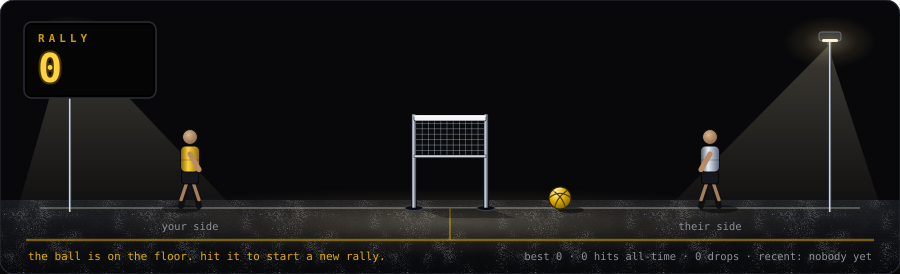

# Shubham Mohape

**Data engineer** · pipelines, scraping, ML ops · Mumbai

I design, build and maintain data pipelines, and I turn messy datasets into something people can act on.
So instead of a banner, this profile is a pipeline.

Every night a GitHub Action extracts my repos and activity from the GitHub API, drops forks and duplicates,
scores each repo into a medallion tier (**bronze**, **silver**, **gold**), writes the layers to [`data/`](data),
runs freshness, volume, schema and uniqueness tests, and redraws the refinery above. Each unit is a pipeline task,
and everything you can see is data from the last real run: the plaques, the fill level in each vat, the lamps, the sight
glasses (mustard liquid flows only when the task succeeded) and the valves (open hand wheel = task ok, red = closed).
The flare stack burns off warnings: a pilot light when everything is clean, a bigger flame when a test warns, a roaring one
when a unit is down. If a task fails its lamp goes red, it leaks, and everything downstream goes dark.
The camera sway is real 3D: ladders, rails, bolts and the lattice mast are re-projected every frame and morphed in plain SVG, with no JavaScript.

<!--LAKE:START-->
| tier | repo | language | what it is |
|---|---|---|---|
| gold | [Faculty-Expertise](https://github.com/shubhammohape/Faculty-Expertise) | PHP | The Website that will help RAIT faculty to manage their data in one place |
| gold | [Bhavgeet](https://github.com/shubhammohape/Bhavgeet) | TypeScript | An AI tool  that predict Music Playlist Based on Human Emotions |
| gold | [Data_extraction](https://github.com/shubhammohape/Data_extraction) | TeX | exe file that extract application  name  its version host name and serial number when executed |
| gold | [Fastapi](https://github.com/shubhammohape/Fastapi) | Python | Simple student database using fastapi |
| gold | [Music_Player](https://github.com/shubhammohape/Music_Player) | CSS | A music player that plays music based on a keyword searched. |
| gold | [Result_Extraction](https://github.com/shubhammohape/Result_Extraction) | Jupyter Notebook | pdf to excel extraction |
| gold | [face_reginition](https://github.com/shubhammohape/face_reginition) | Python | Face recognition using opencv and harrcascade |
| gold | [portfolio](https://github.com/shubhammohape/portfolio) | HTML | Personal Website for some crazy shit!!!! |
<!--LAKE:END-->

## A year of output

That's the calendar GitHub draws as green squares, rebuilt as a flip-disc sign: one disc per day, 53 weeks by 7 days,
so 371 discs. A brighter mustard disc is a busier day. Every few seconds the board refreshes column by column, like the
real thing, and spells out a number from my own year (total, active days, best day, my name) before flipping back.
Same public data as the green graph, rebuilt every night by the pipeline; nothing is hand-edited.

## Query the lake

The same lake is queryable. Open an issue and a workflow runs your SQL against it (read-only SQLite, one `SELECT` per
issue, three seconds, forty rows) and replies with the result table.

<!--SQL:START-->
**One-click queries:** [`tiers`](https://github.com/shubhammohape/shubhammohape/issues/new?title=sql%3A%20SELECT%20tier%2C%20COUNT%28%2A%29%20AS%20repos%2C%20CAST%28AVG%28size_kb%29%20AS%20INT%29%20AS%20avg_kb%20FROM%20repos%20GROUP%20BY%20tier%20ORDER%20BY%20repos%20DESC&body=Press%20%2A%2ASubmit%20new%20issue%2A%2A.%20A%20workflow%20runs%20the%20query%20and%20replies%20here%20in%20about%2030%20seconds.) · [`languages`](https://github.com/shubhammohape/shubhammohape/issues/new?title=sql%3A%20SELECT%20language%2C%20COUNT%28%2A%29%20AS%20repos%20FROM%20repos%20GROUP%20BY%20language%20ORDER%20BY%20repos%20DESC%20LIMIT%205&body=Press%20%2A%2ASubmit%20new%20issue%2A%2A.%20A%20workflow%20runs%20the%20query%20and%20replies%20here%20in%20about%2030%20seconds.) · [`biggest`](https://github.com/shubhammohape/shubhammohape/issues/new?title=sql%3A%20SELECT%20name%2C%20size_kb%2C%20tier%20FROM%20repos%20ORDER%20BY%20size_kb%20DESC%20LIMIT%205&body=Press%20%2A%2ASubmit%20new%20issue%2A%2A.%20A%20workflow%20runs%20the%20query%20and%20replies%20here%20in%20about%2030%20seconds.) · [`dormant`](https://github.com/shubhammohape/shubhammohape/issues/new?title=sql%3A%20SELECT%20name%2C%20SUBSTR%28pushed_at%2C%201%2C%2010%29%20AS%20last_push%20FROM%20repos%20ORDER%20BY%20pushed_at%20LIMIT%205&body=Press%20%2A%2ASubmit%20new%20issue%2A%2A.%20A%20workflow%20runs%20the%20query%20and%20replies%20here%20in%20about%2030%20seconds.) · [`pipeline`](https://github.com/shubhammohape/shubhammohape/issues/new?title=sql%3A%20SELECT%20ts%2C%20extract%2C%20clean%2C%20enrich%2C%20load%2C%20serve%20FROM%20runs%20ORDER%20BY%20ts%20DESC%20LIMIT%205&body=Press%20%2A%2ASubmit%20new%20issue%2A%2A.%20A%20workflow%20runs%20the%20query%20and%20replies%20here%20in%20about%2030%20seconds.) · [`busiest`](https://github.com/shubhammohape/shubhammohape/issues/new?title=sql%3A%20SELECT%20date%2C%20weekday%2C%20count%20FROM%20days%20ORDER%20BY%20count%20DESC%20LIMIT%205&body=Press%20%2A%2ASubmit%20new%20issue%2A%2A.%20A%20workflow%20runs%20the%20query%20and%20replies%20here%20in%20about%2030%20seconds.) · [`weekdays`](https://github.com/shubhammohape/shubhammohape/issues/new?title=sql%3A%20SELECT%20weekday%2C%20SUM%28count%29%20AS%20total%2C%20ROUND%28AVG%28count%29%2C%201%29%20AS%20per_day%20FROM%20days%20GROUP%20BY%20weekday%20ORDER%20BY%20total%20DESC&body=Press%20%2A%2ASubmit%20new%20issue%2A%2A.%20A%20workflow%20runs%20the%20query%20and%20replies%20here%20in%20about%2030%20seconds.) · [`months`](https://github.com/shubhammohape/shubhammohape/issues/new?title=sql%3A%20SELECT%20month%2C%20SUM%28count%29%20AS%20total%2C%20COUNT%28%2A%29%20FILTER%20%28WHERE%20count%20%3E%200%29%20AS%20active%20FROM%20days%20GROUP%20BY%20month%20ORDER%20BY%20total%20DESC%20LIMIT%206&body=Press%20%2A%2ASubmit%20new%20issue%2A%2A.%20A%20workflow%20runs%20the%20query%20and%20replies%20here%20in%20about%2030%20seconds.)
<!--SQL:END-->

Or write your own: title the issue `sql: SELECT ...`. Tables: `repos`, `events`, `runs` and `days` (one row per day of the contribution calendar).

## Keep the rally alive 🏐

**[→ Bump the ball](https://github.com/shubhammohape/shubhammohape/issues/new?title=bump&body=Just+hit+Submit.+The+workflow+does+the+rest.)**
opens a pre-filled issue; submit it and a workflow hits the ball (about 30 seconds). You can't hit it twice in a row,
and if nobody touches it for 24 hours the ball drops and the rally resets.

## Stack

  
  
  
  
  
  
  
  
  
  

## Writing

- [RAG Using Langchain](https://python.plainenglish.io/rag-using-langchain-c371fcd02d13)
- [Langchain for Web Scraping](https://python.plainenglish.io/langchain-for-web-scraping-988027d1fed5)
- [Zero-shot, Few-shot, and Chain of Thought Prompt](https://python.plainenglish.io/zero-shot-few-shot-and-chain-of-thought-prompt-92596a7a1d59)

## Off the clock

Gaming, volleyball, and protecting work-life balance. B.E. Computer Engineering (2022). Always up for
collaboration on data engineering. Open an issue or reach out.
